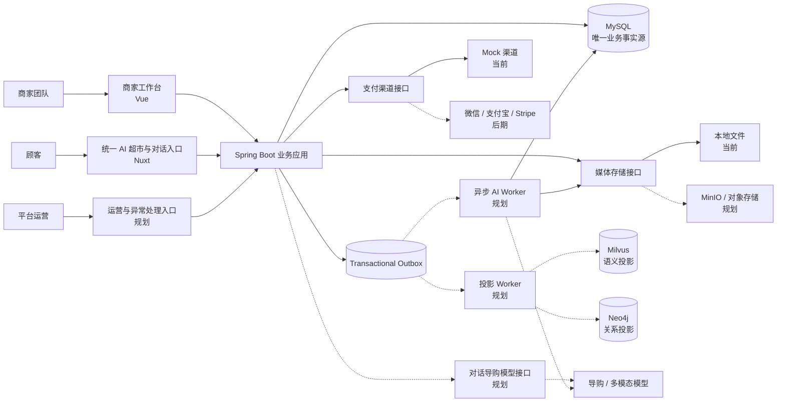
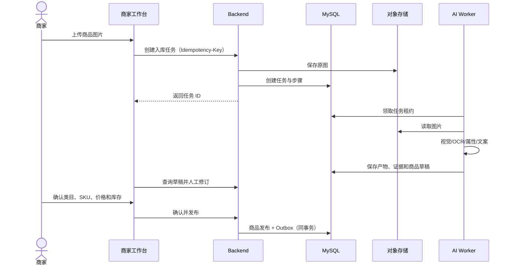
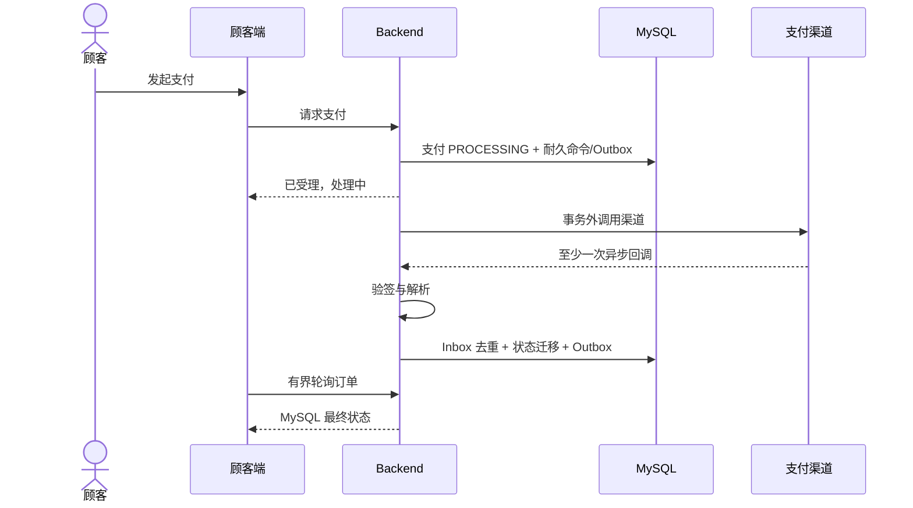
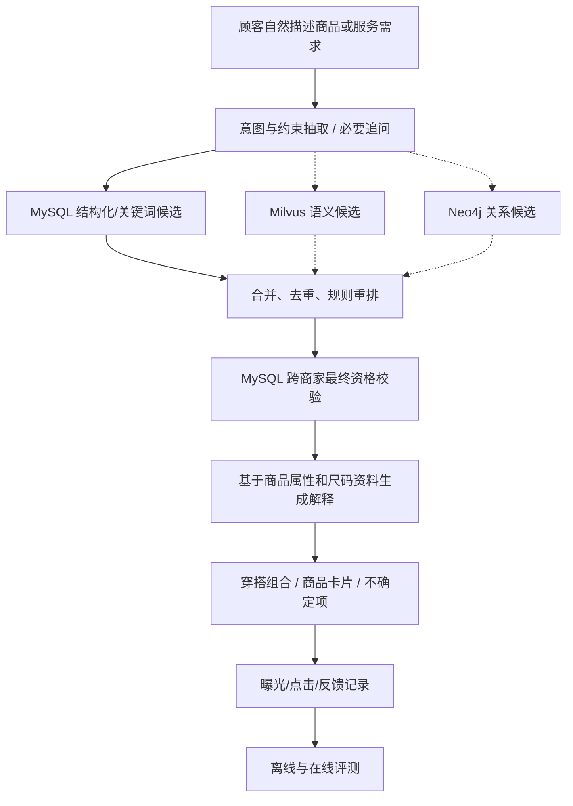
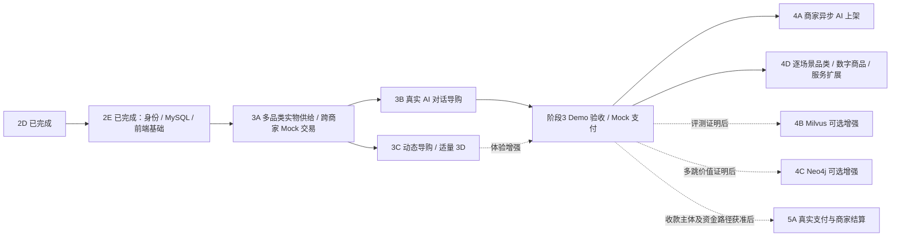

# MegaGraph Shop 全项目系统架构与开发路线基线

> 2026-10-03集成更新：完整阶段3 Demo已获授权提交并合入本地main，详见[集成记录](PHASE_3_MAIN_INTEGRATION.md)；下文10月2日“未合入”是历史快照。真实业务/生产验收、远端推送和阶段4未执行。

> 文档状态：统一多品类 AI 超市、实物/数字（虚拟）商品/服务长期范围及阶段3 Demo范围已确认；具体后续场景、真实收款与扩展API/schema另行冻结
>
> 架构核对代码基线：阶段 2E 集成验收基线（2026-09-26），证据见 [PHASE_2E_ACCEPTANCE.md](PHASE_2E_ACCEPTANCE.md)；历史 2D 基线为 `282fb27`。
>
> 首次核对：2026-09-21；产品边界更新：2026-10-02。代码盘点仍是历史2E基线；当前阶段3按负责人授权完成完整Demo验收，使用测试供给、生成图片和真实导购模型，负责人本人反馈，不要求额外参与者。状态与证据以[阶段3矩阵](PHASE_3_ACCEPTANCE.md)和[Demo交付记录](PHASE_3_DEMO_DELIVERY.md)为准，未合入main；真实业务与生产验收另行开展。
>
> 文档用途：统一产品目标、系统边界、事实来源、目标架构、当前实现、差距和后续阶段；本文件不是某一阶段已经完成的证明。

## 1. 结论与需要关注的偏移

MegaGraph Shop 的顾客端是统一的“AI 超市”：用户从一个对话入口描述需求，AI 在多个商家的已发布商品中寻找、比较并解释选择，顾客在同一购物车中选购，再按商家拆成独立订单。商家使用同一个平台的工作台管理各自商品、库存和履约；第一版不建设每个商家的独立消费者商城。

两条产品闭环都保留，但第一批真实用户试用优先验证顾客侧：

1. **AI 对话购物闭环，首版优先**：顾客用自然语言表达多品类商品或服务需求，系统从跨商家公开资料召回候选，经 MySQL 最终资格校验后推荐有证据的商品；阶段3仅实物可跨商家加购、拆单和Mock支付。虚拟购买、权益交付、服务预约与容量另行冻结，不拿服饰替代这些需求。
2. **AI 商品生产闭环，后续提效**：商家上传图片，系统生成可追踪的商品草稿，商家确认类目、标题、属性、SKU、价格和库存后发布。首批试用商品可以由商家手工录入并确认，不等待这条闭环完成。

项目负责人同时确认顾客端需要高审美、克制的动态和适量高质量 3D，参考苹果官网及海外高端独立站的表达方式。此要求服务于统一 AI 对话购物和商品展示，不意味着为每个商家建立独立品牌官网；动态和 3D 不能破坏性能、可访问性与交易稳定性。

当前阶段 1 和阶段 2A–2E 已经建立商品发布、购物车、订单、库存、履约、退款、异步支付、正式会话、MySQL 运行基础和统一对话入口骨架。它们没有破坏上述架构，但真正的 AI 超市差异化能力仍未完成：

- 真实或可替换的异步 AI Worker；
- AI 产物、模型版本、Prompt 版本和证据的持久化；
- MinIO 等对象存储适配器；
- 对话式导购、跨商家商品召回与推荐 API；
- 跨商家购物车、按商家拆单和独立 Mock 支付；
- 推荐查询、候选、曝光和反馈数据闭环；
- Outbox 的通用投递器、重试、死信和投影重建；
- Milvus 和 Neo4j 的可重建读取投影。

因此，**2D 之后补范围受控的生产身份与 MySQL 基线，然后优先交付可供真实用户试用的 AI 对话购物纵切片**。商家 AI 上架、重型 3D 和可选投影不能成为这条主流程的前置阻塞。

## 2. 文档依据与事实等级

当前 Git 仓库没有保存此前提到的 `技术栈与数据库设计.md`。`main` 已保存阶段 1–2D 文档和 2D 实现，验收记录见 `docs/PHASE_2D_ACCEPTANCE.md`。本文件根据以下内容重建总架构：

- 当前仓库中的 `AGENTS.md`、`README.md` 和 `docs/PHASE_1.md`–`docs/PHASE_2D.md`；
- 当前前后端实现、Flyway V1–V5、共享类型和测试；
- 此前已经形成的产品架构决策：AI 草稿必须由商家确认、MySQL 是业务事实源、Neo4j/Milvus 是可重建投影、推荐返回前必须回查 MySQL；
- 已确认的 AI 超市定位、多品类实物/虚拟商品/服务产品范围、阶段3实物Mock交易、跨商家购物车、商家为销售方与中国大陆首发目标；原女装首批假设已由2026-10-02多品类范围取代，服饰仅为资料样本；
- 已经发生并通过验证的阶段交付结果。

为防止把计划写成事实，本文使用五种状态：

| 标记 | 含义 |
|---|---|
| 已实现 | 当前 `main` 中已经存在代码、迁移或前端实现 |
| 已验证 | 除已实现外，还存在本轮或阶段验收证据 |
| 已确定未实现 | 架构方向已经明确，但当前代码不存在 |
| 已确认但待外部验证 | 产品要求已确认，实际资金路径、渠道准入或主体条件仍无可执行证据 |
| 待负责人确认 | 会改变产品经营模式、阶段优先级或成本，不能由开发者代替决定 |

## 3. 产品定位

### 3.1 服务对象

- **入驻商家团队**：作为各自订单的销售方，维护供给、审核AI草稿、确认价格/可售条件与交付方式，处理各自订单、履约和售后。当前交易实现仅覆盖实物商品。
- **顾客**：从统一对话入口描述需求，获得跨商家商品推荐和比较，实物加入统一购物车、拆单与模拟支付。虚拟商品/服务可讨论需求，但未开放购买、权益或预约。
- **平台运营人员**：管理类目、监控任务与投影、处理异常支付事件、审核跨系统一致性和运营指标。
- **外部提供方**：AI 模型、对象存储、支付渠道、未来物流渠道；全部必须位于可替换适配器之后。

### 3.2 核心价值

```text
首版：顾客通过对话找到、比较并选购可信的跨商家多品类实物
产品范围同时保留虚拟商品与服务，其交易/交付模型另行实现
后续：AI 帮商家更快产出结构化商品资料，持续改善供给质量
```

交易、履约和售后是基础能力。当前Demo先用明确标注的测试商品、真实模型及负责人本人测试检验对话流程；正式商业试用再取得真实商品和参与者反馈。商家 AI 草稿效率是后续独立验证的收益，不能用 Mock 回复冒充真实导购质量。

### 3.3 明确非目标

- 不让 AI 自动决定价格、库存、上架、订单、支付或退款事实。
- 不把顾客端做成每个商家各自拥有的独立商城，也不把传统类目瀑布流当作首屏主入口。
- 不在 MVP 阶段拆成大量微服务。
- 不把 Neo4j、Milvus、Redis 或前端状态当作业务事实源。
- 不在缺少真实数据和评测时写死嵌入模型、向量维度、索引类型或图模型规模。
- 不为了“技术先进”让 LLM 直接执行生成的 SQL、Cypher 或资金操作。
- 在中国大陆的真实资金路径获收款主体、银行或持牌支付机构明确支持前，不以普通商户账户代商家归集货款和自行二次结算。
- 不把真实支付凭据、AI Key、密码、Cookie 或运行数据写入仓库。

### 3.4 长期供给范围与当前边界

“品类”描述顾客找的是什么；“交付类型”决定如何判断可售、预留资源、完成交付和处理售后，两者不能混为一个字段。原主目录未提交的长期范围在本次集成中保留：

| 交付类型 | 典型供给 | 必须另行定义的事实 |
|---|---|---|
| 实物商品 | 服饰及其他实物品类 | SKU库存、收货地址、物流或线下交付、退换货资格 |
| 数字商品 | 数字文件、访问权或使用权益 | 权益范围与期限、发放/撤销、兑换或使用记录、交付失败；是否限量由具体权益决定 |
| 服务 | 预约、远程或按次服务 | 提供方式、可接单条件；预约型服务的时段/容量，以及取消/改期、完成证明与争议 |

当前`product`/`product_sku`、`stock_reservation`、`shipment`和未发货整单退款服务于实物。不能通过新增类目或把数字权益、服务时段写入`sku_name`就宣称另两类可售。扩展须独立冻结交付类型、属性、资格、订单快照、履约和售后，以MySQL记录事实；不预设数字商品无限库存，也不把预约容量当实物库存。阶段2E验收事实保留，当前阶段3已按负责人最新授权扩为多品类实物Demo。

## 4. 不可破坏的架构原则

1. **MySQL 是唯一业务事实源**：商品、SKU、价格、库存、商家、订单、支付、退款、任务和发布状态以 MySQL 已提交数据为准。
2. **实物 SKU 是实物库存唯一事实粒度**：`product_sku.available_stock`保存实物可售库存，商品总库存只能派生；未来数字权益数量和服务时段容量须有独立事实模型。
3. **AI 只生成建议和草稿**：商家必须确认类目、价格、库存、发布等业务事实。
4. **服务端重新校验交易事实**：客户端价格、金额、商家 ID、支付结果和退款金额均不可信。
5. **状态变化与 Outbox 同事务**：业务事实变化和对应事件要么一起提交，要么一起回滚。
6. **外部系统通过端口和适配器接入**：AI、媒体、支付、物流、图数据库和向量数据库不能侵入核心领域规则。
7. **派生系统必须可重建**：Neo4j、Milvus、缓存和搜索索引丢失时，应能从 MySQL 和对象存储恢复。
8. **推荐结果返回前做最终资格校验**：无论关键词、向量或图关系候选，都要在MySQL检查发布、商家、价格、删除状态和对应交付类型的实时资格；当前实物检查SKU库存，未来权益和服务另行冻结。
9. **先模块化单体，再按证据拆分**：只有团队边界、调用规模、资源隔离或独立扩缩容需求明确时才拆服务。
10. **每个阶段必须形成可运行纵切片**：文档、代码、测试、MySQL 和浏览器验收要分别给出证据。
11. **商家管理隔离、公开商品跨商家发现**：商家只管理自己的数据；统一顾客端只读取可公开且通过实时资格校验的商品。
12. **资金路径须有外部准入证据**：入驻商家是订单销售方，平台名下账户先收款是已确认目标；真实支付与结算方案的可行性尚未验证，不得由 Mock 状态机推断为已可上线。

## 5. 系统上下文



实线表示当前已经存在或当前本地实现具备的关系；虚线表示目标架构中已确定但尚未落地的能力。

## 6. 总体逻辑架构

### 6.1 运行单元

目标架构优先保持以下运行单元：

| 运行单元 | 职责 | 当前状态 |
|---|---|---|
| `merchant-web` | 商品入库、草稿确认、发布、订单、履约和售后工作台 | 已实现基础能力 |
| `shopper-web` | 统一 AI 对话入口、跨商家穿搭推荐、购物车、拆单结算和订单 | 当前只有商品浏览与单商家交易基础 |
| `backend` | 身份、租户、目录、交易、支付、售后、任务和 API | 已实现模块化单体 |
| AI Worker | 异步读取任务、调用模型、保存可追踪产物和推进草稿 | 已确定未实现 |
| Projection Worker | 消费 Outbox，更新搜索、Milvus、Neo4j，并管理重建 | 已确定未实现 |
| MySQL | 所有内部业务事实、任务、幂等和事件 | 已实现；生产运行基线待补 |
| 对象存储 | 原图、派生图和模型输入输出附件 | 本地文件已实现，MinIO 未实现 |
| Milvus | 语义向量读取投影 | 延后到评测证明价值后 |
| Neo4j | 商品、属性、场景和关系读取投影 | 延后到多跳价值被证明后 |
| Redis | 缓存、限流或高并发会话 | 非当前前置条件 |

### 6.2 为什么暂不拆微服务

商品发布、库存、订单、支付和退款需要清晰的事务边界。当前团队和流量没有证明拆分收益，过早拆分会引入分布式事务、事件顺序、跨服务调试和部署成本。

允许未来拆分的判断条件包括：

- AI 推理需要独立 GPU、队列和扩缩容；
- 投影构建吞吐和业务 API 资源争抢；
- 团队已经形成稳定的模块所有权；
- 某模块有独立安全或合规边界；
- 监控数据证明模块需要独立伸缩。

AI Worker 和 Projection Worker 可以先作为独立进程，但不能拥有商品、库存或交易事实。

### 6.3 统一 AI 超市的顾客体验、动态与 3D 架构

#### 6.3.1 已确认的体验定位

顾客端 `shopper-web` 是统一的 AI 超市。首页保持空白Agent对话和底部输入框，开始时不展示商品，推荐后才呈现商家图片；用户无需先选商家店铺。视觉参考保留以下三类能力：

- 苹果式的信息秩序：大幅留白、清晰层级、精确排版、克制色彩和每屏一个重点；
- 海外高端独立站的内容表达：服装质感、真实穿搭摄影、编辑式叙事和明确购买入口；
- MegaGraph Shop 的差异化：对话中理解需求、追问、推荐跨商家商品并给出可核查的穿搭理由。

平台视觉可以有品牌首页，但它应引导对话购物，而非替代对话入口。“动态官网”不等于堆叠动画，“3D 官网”也不等于让每件衣服自动旋转。页面必须在没有 WebGL、动画被关闭或资源尚未加载时仍能对话、浏览和购买。

#### 6.3.2 页面体验分层

| 页面层级 | 页面范围 | 动态与 3D 策略 |
|---|---|---|
| 高动态入口层 | AI 超市首页、示例问题、平台视觉叙事、重点穿搭专题 | 用克制动效吸引用户输入需求；视频、分层图像和局部 3D 只服务于入口表达 |
| 中动态导购层 | 对话、追问、跨商家推荐卡片、穿搭组合、比较和商品详情 | 对话与商品信息优先；需求修改后清楚展示候选变化和证据，避免动画干扰比较 |
| 低动态交易层 | 登录、注册、购物车、结算、支付、订单、退款、售后 | 稳定、清晰、可信；只保留状态反馈和必要过渡，不使用重型 3D 或滚动劫持 |

同一个 Nuxt 应用承载这三层体验。商家品牌可以体现在商品卡片和详情的来源信息中，但不会因此生成各自独立的消费者商城。三层共享统一身份、购物车、商品契约和设计 Token，动效强度不同。

#### 6.3.3 前端渲染边界

- 首页关键标题、公开商品详情、价格、说明、链接和结构化内容必须存在于 SSR 输出中，不能只画在 Canvas；个人对话内容按权限在客户端加载。
- 首屏先提供可读的 HTML、字体和静态视觉，再渐进加载动态与 3D。
- 3D 渲染只在浏览器端启动；服务端输出稳定封面图、海报帧或视频降级内容。
- 3D、视频、序列帧和高清图片按路由、视口和交互意图延迟加载。
- 路由离开、组件卸载或页面隐藏时，必须停止渲染循环并清理监听器、计时器、纹理、几何体和 GPU 资源。
- 不依赖动画结束才能提交提问、阅读推荐、加购或购买；动画失败不能阻断交易。
- 不把核心页面滚动完全接管为自定义滚动系统，避免破坏浏览器行为、键盘导航和可访问性。

#### 6.3.4 设计系统与动效系统

阶段 2E 应建立统一而不过度的前端基础：

- 颜色、字体、字号、行高、间距、圆角、阴影、层级和响应式断点；
- 动效时长、缓动、延迟、位移幅度、进入/退出和状态切换 Token；
- 导航、页脚、对话输入、消息、追问、穿搭组合、商品卡片、状态提示和骨架屏；
- 页面切换、滚动进入、悬停、展开、筛选和异步状态变化的统一规则；
- 默认动效、减少动态模式、低性能模式和无 WebGL 模式；
- 动效组件的生命周期、清理和测试约束。

设计系统是 3B/3C 的基础，但 2E 不承担完整对话导购和 3D 场景交付，避免认证/MySQL 基线被视觉重构吞掉。

#### 6.3.5 3D 内容与媒体契约

阶段 3A 建立多品类商品媒体时，应为后续3D准备可扩展契约，不把二进制模型直接塞进商品表。建议媒体元数据能够区分：

- 原始商品图片；
- 优化后的响应式图片和预览图；
- 视频、海报帧和序列帧；
- 3D 模型及其格式、版本、尺寸和文件哈希；
- 材质、纹理、环境贴图和压缩变体；
- 桌面端、移动端和静态降级资源；
- 版权、来源和处理状态。

多品类供给优先保证可信图片和对应的材质、规格及用途资料；服饰还须成衣测量。是否制作3D取决于素材可信性、成本和展示收益。缺少可信模型、材质、灯光和镜头时使用静态图片与轻量交互，不用几何替身代替商品证据。本轮具体决策与降级验收见 [3C](PHASE_3C.md)。

#### 6.3.6 3D 商品交互候选

只有在帮助用户理解商品的情况下，才考虑：

- 鼠标、触摸或陀螺仪控制的有限角度观察；
- 局部放大和细节热点；
- 材质或颜色切换；
- 面料纹理、服装细节和搭配部位的热点；
- 从穿搭组合自然过渡到各件商品的尺码表、SKU 和购买入口。

这些交互不能伪造库存、颜色、规格或穿着效果。虚拟展示不能保证合身；可购买选项以 MySQL 返回的 SKU 事实为准，尺码建议必须引用商家提供的尺码资料。

#### 6.3.7 降级、性能和可访问性

- WebGL 不可用时显示静态封面、视频或序列帧。
- 移动端、弱网和低性能设备使用更轻的模型、纹理、帧率或静态资源。
- 尊重用户的减少动态偏好，关闭非必要位移、视差和滚动驱动效果。
- 首屏主体和主要操作不能等待 3D 包下载完成。
- 对话、推荐卡片和交易操作必须支持键盘、触摸和屏幕阅读器；Canvas 旁提供语义化文本和操作替代。
- 交易页面不加载不需要的 3D 运行时和大型媒体资源。
- 动效与 3D 必须纳入性能预算、真机测试、浏览器兼容和内存/GPU 泄漏检查。

#### 6.3.8 开发顺序

```text
现在：统一空白对话入口、多品类产品与阶段3实物Mock交易
→ 2E：正式身份、MySQL、设计 Token 和页面骨架
→ 3A：测试商家确认的多品类资料、规格与媒体契约、跨商家 Mock 交易和对话基线
→ 3B：真实 AI 对话导购与Demo评测、负责人测试
   与
   3C：对话/穿搭动态体验和适量 3D
   可在 3A 契约冻结后并行，但试用验收依赖 3B 的真实模型证据
→ 4A：商家异步 AI 上架，扩大商品供给
→ 4D：按选定场景逐次扩展数字商品与服务交付，以及后续实物品类
```

当前沿用已确认Agent界面与既有视觉，不再次以参考页/品牌资料作为开工前置。Demo使用明确标注的生成图片；缺少可信3D资产时采用静态和轻量动态，不强制新增3D。真实供给和额外用户反馈属于后续正式试用，不阻塞本轮Demo退出；负责人实际反馈如实记录，不由模型补造。

## 7. 仓库与代码边界

```text
apps/
  backend/                  Spring Boot 模块化业务应用
    api/                    HTTP 契约与请求/响应模型
    identity/               用户、商家、成员角色
    ingestion/              图片入库任务和草稿生成端口
    media/                  媒体校验与存储端口
    catalog/                类目、商品、图片、SKU、发布
    commerce/               购物车、订单、库存预占、履约、售后
    payment/                渠道回调、Inbox、异步命令和退款尝试
    projection/             当前仅有 Outbox 事实；消费者尚未实现
    security/               当前身份解析与访问控制
    shared/                 统一领域错误
  merchant-web/             Vue 3 商家工作台
  shopper-web/              Nuxt 统一 AI 超市、对话导购与交易入口
packages/
  domain-types/             两个前端共享的领域类型与状态辅助函数
docs/
  PHASE_*.md                每阶段范围和验收契约
  SYSTEM_ARCHITECTURE.md    全项目目标架构与路线基线
```

前端共享包只能承载前端契约和无副作用的状态辅助函数。后端 Java 领域模型仍是服务端业务规则的实现位置；不能让 TypeScript 类型反向成为资金或库存事实裁决者。

## 8. 领域边界

### 8.1 身份与商家租户

核心模型：

```text
app_user
merchant
merchant_user(merchant_id, user_id, role)
```

约束：

- 用户可以通过 `merchant_user` 属于商家并拥有 `OWNER`、`EDITOR`、`PUBLISHER` 或 `VIEWER` 角色。
- 商家 API 的 `merchant_id` 必须从已认证身份与成员关系推导，不能相信客户端参数。
- 顾客、商家成员和平台运营角色必须分开授权。
- 顾客端在统一商品目录中可跨商家读取已发布的公开资料；草稿、内部成本、商家员工、未公开媒体、订单处理和 AI 任务仍按 `merchant_id` 隔离。
- AI 导购只能使用公开候选，不能因对话请求或模型输出绕过商家边界；每次返回推荐前仍按 MySQL 当前事实检查。
- 当前两个前端使用服务端 Session；Basic Auth 只保留为受限旧测试替身，不能作为生产浏览器认证方案。

### 8.2 商品入库与 AI 草稿

核心模型：

```text
ingestion_job
ingestion_step
product
product_image
product_sku
```

目标流程：

```text
上传图片
→ 校验格式、大小和安全性
→ 写入对象存储
→ 创建持久化 ingestion_job
→ 异步 Worker 获取租约
→ 视觉理解 / OCR / 属性规范化 / 文案草稿
→ 保存 AI 产物、证据和模型版本
→ 生成或更新商品草稿
→ 商家确认必填事实
→ 发布
```

当前实现是在上传请求事务内调用 `MockDraftGenerator`，根据文件名同步生成草稿，再写入本地文件。这足以验证阶段 1 的业务状态机，但不是目标异步 AI 架构。

未来 AI 产物至少需要记录：

- provider、model、model version；
- Prompt/template version；
- 输入图片及其哈希；
- 结构化输出原文；
- 解析和规范化结果；
- 置信度或证据；
- token/调用费用和耗时；
- 重试次数、错误码和人工修订差异。

### 8.3 商品目录与发布

`product` 保存商品层资料和发布生命周期，`product_sku` 保存可售变体、价格、币种和库存。

多品类实物由商家确认类别、材质、规格、用途与图片来源，可售组合落到SKU。服饰资料另包含颜色、版型、季节和成衣测量；通用实物使用对应SKU规格，不套用胸围或人体合身。虚拟权益与服务容量不落入实物SKU库存。建议必须引用商家资料，同名尺码不等价，图片不能证明性能或合身。

扩品类时共同字段与品类特有属性分开定义，分别冻结必填资料、购买选项、推荐证据和未知项处理。数字授权范围、服务时段/地点不能套用服装尺码表；现有SKU的名称、价格和实物库存不构成这些新类型的已实现契约。

商品草稿状态：

```text
EDITING → READY_FOR_CONFIRMATION → CONFIRMED
```

商品发布状态：

```text
UNPUBLISHED → PUBLISHED → OFF_SHELF → ARCHIVED
```

发布前服务端必须验证：

- 类目存在且允许发布；
- 标题和主图完整；
- 至少一个有效 SKU；
- SKU 编码在商家内唯一；
- 价格、币种和库存合法；
- 商家状态有效；
- 调用人有发布权限；
- 乐观锁版本没有过期。

### 8.4 购物车、订单与库存

当前 2D 实现：

- 购物车和订单只包含同一商家 SKU；
- 创建订单时服务端重新读取价格和可售性；
- 订单保存商品、SKU、价格、币种和收件信息快照；
- 创建订单时扣减 `available_stock` 并创建 `RESERVED` 预占；
- 支付成功只确认预占，不再次扣库存；
- 支付失败、取消或超时只释放一次；
- 退款成功把 `CONFIRMED` 预占变为 `RESTOCKED` 并回补一次。

已确认的试用目标：一个顾客购物车可以包含多个商家的已发布商品；提交时按商家拆出独立子订单，每张子订单只属于一个 `merchant_id`，服务端分别重算价格、库存、运费适用规则与订单快照。一次提交可以形成下单组，但下单组只是聚合视图，不替代子订单的支付、履约、售后和库存事实。试用阶段按子订单分别执行 Mock 支付；A 模拟支付成功、B 失败时，A 保留成功状态，B 可按既有规则重试或到期释放预占，不跨商家回滚成功结果。跨商家优惠、真实合并支付和真实平台结算均不属于这次 Mock 试用。

面向真实用户开放 Mock 支付时，试用订单和库存必须与未来真实交易隔离；后端和商家工作台都应标明“模拟支付”，并阻止试用订单触发真实发货、商家结算和真实退款。不能只依赖顾客端文案阻止商家把未收款订单当作已付款订单履约。

### 8.5 支付与退款

未来跨类型购物车仍按商家拆单，订单项保留交付类型和购买时约定：实物库存/物流、数字权益发放、预约容量/履行分别建模；不能由一个`SHIPPED`或通用`available_stock`推断所有类型的交付。不同商家的成功结果不互相回滚；同一子订单混合类型的取消/退款另行冻结，目前交易代码不支持。

支付渠道输入是不可信外部输入。统一回调入口的内部处理顺序必须是：

```text
保留 raw body
→ 按 provider 选择验签器
→ 验签
→ 解析为内部 ChannelEvent
→ Inbox 唯一约束去重
→ 校验资源、金额、币种和状态
→ 锁定本地事实
→ 幂等状态迁移
→ 同事务写 Outbox
→ 返回渠道响应
```

系统只承诺“渠道可至少一次投递，业务结果最多生效一次”，不宣称无法证明的端到端恰好一次。

当前 Mock 渠道通过持久化 `payment_channel_command` 生成已签名回调，已经具备失败重试和过期领取恢复基础。真实渠道接入时必须实现各自的验签、解析、下单、查单、退款和对账适配器，不能复用 Mock HMAC 作为生产协议。

已确认的未来商业要求是：中国大陆首发；各入驻商家为其商品订单的销售方；顾客货款必须实际先进入 MegaGraph Shop 名下账户，再向商家结算。MegaGraph Shop 的收款主体目前尚未设立。该资金路径的可执行性属于**已确认但待外部验证**，不能由普通商户号、Mock 支付或“商家账户冻结、平台控制解冻”的方案代替。中国人民银行曾将网络平台先归集客户资金、再结算至二级商户纳入整治范围；微信支付当前服务商模式明确由子商户账户收款，服务商账户不直接收款。真实支付阶段必须先取得银行或持牌支付机构对该具体主体、商家销售方、账户归属和资金路径的明确支持，并核定合同、票据、退款、争议、结算及对账责任；未取得证据前不承诺真实收款上线。[中国人民银行答复](https://www.pbc.gov.cn/zhengwugongkai/4081330/4081344/4081419/4081727/2025080819055125759/2020022716130667785.pdf)、[微信支付接入模式](https://pay.wechatpay.cn/doc/v3/partner/4012081931)。

### 8.6 履约与售后

当前每张订单最多一张物流单，只支持商家填写承运商与物流单号、顾客确认收货。

当前售后只支持已支付未发货订单的整单退款；已发货退货、部分退款、多次售后、仲裁和换货均未实现。后续扩展必须先明确售后工单、退货物流、收货质检和累计退款约束，不能在现有单次售后表上直接堆状态。

### 8.7 Outbox 与投影

当前实现已经在领域事务中写入 `outbox_event`，但通用事件发布和投影基础设施尚未完成。目标生命周期应为：

```text
PENDING
→ PROCESSING（带租约）
→ PUBLISHED
或 RETRY_WAIT（退避）
→ DEAD_LETTER
```

投影消费者必须保存：

- 消费者名称；
- aggregate/event version；
- 最近成功事件；
- 租约与重试信息；
- 失败摘要；
- 单商品重建和全量重建状态。

投影处理必须幂等，并拒绝旧版本覆盖新版本。全量重建优先采用新索引/新集合构建完成后切换别名的蓝绿方式。

### 8.8 搜索与智能推荐

推荐不是“把用户问题直接交给 LLM”。目标处理链路是：

```text
多品类商品/服务需求及必要追问
→ 意图、预算、场景、季节、颜色、版型、尺码资料和限制抽取
→ MySQL 结构化过滤与关键词基线
→ 可选 Milvus 语义召回
→ 可选 Neo4j 关系扩展
→ 跨商家候选合并、去重和穿搭规则重排
→ MySQL 批量最终资格校验
→ 返回上装/下装等商品组合、商家来源、依据与不确定项
→ 记录对话、查询、候选、曝光、点击和反馈
```

MySQL 最终资格校验至少检查：

- 商品为 `PUBLISHED`；
- 商品未删除，当前实物SKU也须未删除；
- 商家为 `ACTIVE`；
- 当前实物SKU为`ENABLED`；未来权益/服务选项状态另行定义；
- 当前实物SKU的`available_stock > 0`；未来数字商品核验可发放性，预约型服务核验选定时段容量，其他服务核验接单条件；
- 价格和币种仍然有效。

LLM 可以追问、解析意图和组织解释，但不能凭空生成商品事实、虚构尺码合身保证，也不能绕过最终资格校验。首批真实用户试用需要真实模型或经实际调用验证的模型服务；Mock 回复只能验流程，不能作为 AI 导购质量通过的证据。对话内容应最小化留存个人信息，并保留可复现推荐的商品、规则和模型版本。

## 9. 数据架构

### 9.1 存储职责

| 存储 | 保存内容 | 是否事实源 | 当前状态 |
|---|---|---:|---|
| MySQL | 身份、商家、商品、SKU、库存、对话/推荐记录、任务、订单、支付、退款、Outbox | 是 | 当前只具备部分领域事实；生产基线待补 |
| H2 | 本地快速开发和集成测试 | 否 | 当前默认 local/test |
| 本地文件 | 本地开发图片 | 否 | 已实现 |
| MinIO / 对象存储 | 原图、派生媒体、AI 输入输出附件 | 媒体二进制事实 | 已确定未实现 |
| Milvus | 商品文本/图片向量、语义候选 | 否，可重建 | 延后验证 |
| Neo4j | 商品、属性、品牌、场景和关系投影 | 否，可重建 | 延后验证 |
| Redis | 缓存、限流、热点数据或未来会话 | 否 | 当前不需要 |

### 9.2 当前 MySQL 表分组

| 领域 | 当前表 |
|---|---|
| 身份与租户 | `app_user`、`merchant`、`merchant_user` |
| 商品目录 | `category`、`product`、`product_image`、`product_sku` |
| AI 入库 | `ingestion_job`、`ingestion_step` |
| 交易 | `shopping_cart`、`shopping_cart_item`、`sales_order`、`sales_order_item` |
| 库存预占 | `stock_reservation` |
| 支付 | `payment_order`、`payment_attempt` |
| 履约 | `shipment` |
| 售后退款 | `after_sale_request`、`refund_order`、`refund_attempt` |
| 外部事件 | `payment_channel_event`、`payment_channel_command` |
| 事件发布 | `outbox_event` |

### 9.3 后续需要新增或补强的数据

- 多品类实物属性、SKU规格、用途与商家确认依据；服饰包含独立成衣尺码表；
- 后续品类属性规则与交付类型；权益发放/撤销/使用、服务时段/容量/预约/改期，以及逐类型履约和售后事实；
- 统一购物车的跨商家条目、一次提交形成的下单组，以及每个商家的独立子订单；
- 对话会话、轮次、结构化需求、追问、候选快照、穿搭组合与模型/规则版本；
- AI artifact 与模型/Prompt 版本；
- 任务租约、退避重试和死信；
- 投影消费者状态、版本游标和重建任务；
- 推荐 query、candidate、result、exposure、click 和 feedback；
- 搜索/推荐离线评测集和指标快照；
- 真实支付的渠道账单、商家应结算、结算尝试和人工处理状态，仅在资金路径获得外部支持并冻结契约后设计落地；
- 如果支持已发货售后，再增加可扩展的售后工单、退货和部分退款事实。

## 10. 关键业务流程

### 10.1 AI 商品生产闭环



### 10.2 下单与库存

当前代码只有单商家下单。以下是新增的跨商家试用目标：

```text
读取统一购物车
→ 服务端识别商家并按固定顺序锁定、校验各 SKU
→ 按商家分别重算金额和可售性
→ 原子创建下单组与每商家一张子订单、快照、库存预占及 Mock 支付单
→ 同事务写入对应订单 Outbox
→ 返回子订单列表及各自待支付状态
→ 顾客按子订单分别模拟支付；各订单独立进入履约或失败恢复
```

如果任一 SKU 在提交时不可售，整个提交失败并提示重新确认购物车；支付阶段发生的部分成功则按子订单保留真实结果，不把已成功的订单一起回滚。

### 10.3 异步支付



### 10.4 退款

```text
顾客申请未发货退款
→ 暂停发货
→ 商家 OWNER 批准
→ 创建退款事实与 attempt
→ 提交异步渠道命令
→ 渠道退款回调验签和 Inbox 去重
→ 成功时订单/支付/售后/预占/库存同事务迁移
→ 前端轮询获得最终状态
```

### 10.5 智能商品发现闭环



## 11. 核心状态机

状态机必须独立，不能用一个总状态推断全部事实。

### 11.1 当前已实现状态

| 对象 | 当前状态 |
|---|---|
| 商品草稿 | `EDITING`、`READY_FOR_CONFIRMATION`、`CONFIRMED` |
| 商品发布 | `UNPUBLISHED`、`PUBLISHED`、`OFF_SHELF`、`ARCHIVED` |
| 入库任务 | `QUEUED`、`RUNNING`、`SUCCEEDED`、`PARTIAL_SUCCESS`、`FAILED`、`CANCELLED` |
| 订单 | `PENDING_PAYMENT`、`PAID`、`SHIPPED`、`COMPLETED`、`REFUNDED`、`PAYMENT_FAILED`、`CANCELLED`、`EXPIRED` |
| 支付 | `PENDING`、`PROCESSING`、`SUCCEEDED`、`REFUNDED`、`FAILED`、`CANCELLED` |
| 库存预占 | `RESERVED`、`CONFIRMED`、`RESTOCKED`、`RELEASED` |
| 物流 | `SHIPPED`、`DELIVERED` |
| 售后 | `REQUESTED`、`REFUND_PROCESSING`、`REFUNDED`、`REFUND_FAILED`、`REJECTED` |
| 退款 | `PENDING`、`PROCESSING`、`SUCCEEDED`、`FAILED` |
| 渠道事件 | `RECEIVED`、`APPLIED`、`REJECTED`、`REVIEW_REQUIRED` |
| 渠道命令 | `PENDING`、`PROCESSING`、`COMPLETED`、`FAILED` |

### 11.2 状态机约束

- 状态转换必须由领域服务执行，控制器不能直接修改实体状态。
- 重复事件只能返回原结果或无操作，不能重复扣减、释放或回补库存。
- 乱序或矛盾事件必须进入 `REVIEW_REQUIRED`，不能强行覆盖已提交事实。
- 退款处理中和退款失败状态仍阻止发货，直到人工决策或成功重试。
- 前端轮询超时只代表暂时未获终态，不能显示为业务失败。
- 未来下单组的展示状态只能从子订单汇总，不能覆盖各商家的支付、退款或履约事实；真实商家结算状态必须与订单状态独立。

## 12. API 边界

### 12.1 当前 API 分区

| 前缀 | 使用方 | 当前职责 |
|---|---|---|
| `/api/merchant/v1/**` | 商家工作台 | 商家身份、入库、草稿、发布、订单、履约、售后 |
| `/api/shop/v1/**` | 顾客端 | 公共商品、购物车、订单、支付模拟、收货和售后 |
| `/api/auth/v1/**` | 两端身份 | CSRF、邀请注册、Session 登录、当前身份与退出 |
| `/api/payment-callbacks/{provider}` | 支付渠道 | 免会话但必须渠道验签的回调入口 |

### 12.2 后续 API 原则

- 身份 API 应提供注册、登录、退出和当前身份，不暴露密码哈希。
- AI 任务创建与状态查询分离；创建请求不等待模型完成。
- 对话 API 以会话和轮次承载需求、必要追问、跨商家候选、穿搭组合、商品证据与不确定项；模型回复不能直接成为价格或库存事实。
- 后续推荐须说明品类、交付类型、商家确认依据和未确认条件，不能互相代用尺码、数字权益或服务预约资格。
- 推荐 API 返回候选、商家来源、证据和查询 ID，用于后续曝光/反馈归因。
- 跨商家购物车提交 API 返回下单组和各商家子订单；支付、履约、退款仍按子订单执行。具体路径、字段及幂等键在对应阶段文档冻结。
- 管理型重建、死信重放和异常处理 API 必须有平台级权限和审计。
- 所有创建、提交、重试和外部事件操作应使用幂等键或唯一约束。
- 错误响应必须有稳定错误码，前端不能依赖自然语言错误文本分支业务逻辑。

## 13. 身份、安全与租户隔离

### 13.1 当前状态

- Spring Security 使用服务端 Session，Spring Session JDBC 持久化；
- 公共商品和媒体读取允许匿名；
- 支付回调免会话认证，但由渠道签名保护；
- 浏览器写操作启用 CSRF，支付回调仅豁免会话/CSRF，仍须验签；
- 商家请求显式携带 `X-Merchant-Id`，逐请求校验账号、商家、成员关系和角色；
- `trial` 强制 MySQL、关闭固定开发账号种子、启用 Secure Cookie，并拒绝混用 local/test；local/test 仍可用于离线开发和测试；
- 邀请码哈希持久化、一次性兑换；注册和账号创建同事务；
- 密码使用 Spring Security `PasswordEncoder`。

上述 2E 基础已通过本地 MySQL 和浏览器验收，但仍未开放真实用户试用。对外部署须配置同源 HTTPS；当前按单实例/IP 的登录限流还需结合可信代理与部署拓扑落地。跨商家 Mock 交易和真实导购分别由 3A、3B 交付。

### 13.2 目标状态

- 同一自有网站优先使用服务端 Session；
- Cookie 使用 `HttpOnly`、合适的 `SameSite`、生产环境 `Secure`；
- Session 初期可以使用 Spring Session JDBC 存入 MySQL，无需提前引入 Redis；
- 对浏览器写操作启用并正确处理 CSRF；
- CORS 使用明确允许来源，不允许任意来源携带凭据；
- 登录、注册、回调和高风险动作需要限流；
- 商家角色与 `merchant_id` 在服务端联合校验；
- 日志不得输出密码、Cookie、Authorization、支付原始敏感字段或真实密钥；
- 图片上传需要内容类型、实际文件格式、大小、恶意内容和文件名安全检查；
- AI 输入中的文字视为不可信内容，不能作为系统指令执行。

## 14. 一致性、幂等和并发

### 14.1 本地强一致事务

以下变化应在单个 MySQL 事务中完成：

- 商品发布状态与发布 Outbox；
- 创建订单、扣减可售库存、库存预占、支付单与订单 Outbox；
- 未来一次跨商家提交的下单组、各子订单、库存预占、Mock 支付单与 Outbox；
- 支付/退款 Inbox 结果、业务状态、库存和 Outbox；
- 发货或确认收货状态与 Outbox。

### 14.2 外部最终一致

以下操作必须在数据库事务之外执行，并通过耐久任务重试：

- 调用 AI 模型；
- 调用支付下单、查单和退款；
- 获得外部支持后调用真实商家结算渠道及下载结算账单；
- 更新 Milvus/Neo4j；
- 发送通知；
- 下载或处理外部账单。

### 14.3 并发策略

- SKU 和资金相关实体采用固定顺序加锁；
- 商品编辑使用版本号做乐观锁；
- 渠道事件以 `(provider, provider_event_id)` 唯一约束作为最终去重裁决；
- 任务领取使用租约和过期恢复，不能只依赖进程内锁；
- 失败重试必须有上限、退避和死信，不能无限热循环；
- 冲突不能通过“最后写入获胜”悄悄覆盖。

## 15. 搜索、图谱和向量投影策略

### 15.1 MySQL 基线优先

在引入 Milvus 或 Neo4j 前，先用 MySQL 建立：

- 结构化属性过滤；
- 类目、标题和 SKU 关键词检索；
- 可重复的查询集；
- Recall@K、NDCG、无结果率、资格过滤率和响应时间基线。

没有基线就无法证明新增数据库带来收益。

### 15.2 Milvus 的准入条件

只有在真实查询证明关键词/结构化检索无法覆盖语义表达时才引入。引入前必须确定：

- 文本、图片或多模态嵌入模型；
- 模型和向量空间版本；
- 重建策略；
- 规模、召回率和延迟目标；
- 模型切换时的全量重建方案。

“维度相同”不代表向量兼容。

### 15.3 Neo4j 的准入条件

只有在多跳关系能提高推荐或解释质量时才引入，例如：

- 商品适用场景与人群；
- 商品之间的搭配、替代或互补；
- 类目、属性、品牌和主题之间的关系；
- 推荐解释需要展示可验证关系路径。

如果查询主要是属性过滤和语义相似，Neo4j 不应为了名称中的 “Graph” 被强行加入。

## 16. 可用性、降级与可观测性

### 16.1 降级原则

| 依赖故障 | 系统行为 |
|---|---|
| AI Provider 不可用 | 任务进入重试/失败，商家可手工创建和编辑商品 |
| 对象存储不可用 | 禁止新上传；不影响已有纯数据库交易事实 |
| Milvus 不可用 | 降级到 MySQL 关键词和结构化检索 |
| Neo4j 不可用 | 跳过关系扩展，不影响商品最终资格校验 |
| LLM 解释不可用 | 返回结构化候选和规则证据，不生成自然语言解释 |
| 支付回调延迟 | 显示处理中，通过回调和主动查单恢复，不伪造失败 |
| 投影滞后 | 记录延迟，仍以 MySQL 最终校验阻止错误商品返回 |
| 导购模型不可用 | 显示可理解的失败/重试状态与结构化商品检索入口，不伪造 AI 回复或交易资格 |
| 某商家 Mock 支付失败 | 保留其他商家已成功子订单，只重试或取消失败子订单 |
| WebGL 不可用 | 使用静态封面、视频或序列帧，不影响浏览和购买 |
| 3D/高清媒体加载失败 | 保留 SSR 文本、商品图片、SKU 选择和交易入口 |

### 16.2 关键指标

- API 成功率、P95/P99 延迟和错误码分布；
- 数据库连接、慢查询、锁等待和死锁；
- 入库任务排队时间、执行时间、成功率、重试和死信；
- AI 模型耗时、token/调用成本、结构化解析失败率和商家修改率；
- Outbox backlog、最老事件年龄、投影延迟和重建进度；
- 支付回调验签失败、重复、冲突、待核查和处理延迟；
- 库存释放/回补异常和对账差异；
- 搜索无结果率、最终资格过滤率、点击率、转化率和推荐反馈。
- 导购追问完成率、推荐理由的证据覆盖率、穿搭组合接受率、跨商家加购率和人工评测质量；
- 跨商家提交失败率、子订单部分支付比例、重复提交与库存预占释放异常；
- 顾客端首屏、页面切换、交互响应、布局稳定性和资源体积；
- 3D 场景初始化耗时、帧率、内存/GPU 占用、降级触发率和加载失败率；
- 减少动态、无 WebGL、移动端、弱网和低性能模式的可用性结果。

## 17. 测试与发布准入

### 17.1 测试层次

- 领域单元测试：状态转换、金额、资格规则和幂等判断；
- H2 集成测试：快速覆盖 Spring、JPA、Flyway 和业务纵切片；
- MySQL 集成/冒烟：验证真实 DDL、唯一约束、时间精度、锁和迁移；
- 前端共享状态测试：轮询、状态映射和按钮资格；
- 跨商家交易集成测试：同一次提交拆单、任一 SKU 不可售时整体拒绝、子订单部分 Mock 支付成功与重试/超时释放；
- 导购评测：多品类已确认供给、固定需求问题、追问、规格与属性证据、虚拟/服务范围识别、无库存/下架过滤，以及真实模型输出的人工复核；
- 前端类型检查与生产构建；
- 浏览器验收：关键用户旅程、刷新恢复、权限和错误状态；
- 当前Demo验收：从统一对话入口表达多品类需求，查看跨商家商品、修改条件、加入购物车、拆单和分别完成Mock支付；前后端标明测试/模拟且阻止真实履约。正式试用另补真实资料与参与者任务反馈；
- 视觉回归：关键视口、主题、页面状态和静态降级画面；
- 动效验收按实际范围：当前Demo检查静态/图片失败、减少动态、键盘和小屏；后续若引入3D或正式设备试用，再检验真机/触摸/资源释放和无WebGL降级；
- 后续投影契约测试：事件版本、幂等、重建和降级；

### 17.2 阶段完成的共同证据

```text
契约已冻结
+ 前后端业务契约与实际实现一致
+ 相关自动化测试通过
+ MySQL 证据通过
+ 前端构建通过
+ 关键浏览器流程通过
+ 无真实凭据泄露
+ 供给与反馈满足当前明确范围：本轮Demo为标明的测试供给与负责人反馈；正式商业试用另核实真实供给/参与者
+ 负责人集中验收确认
= 阶段完成
```

任何单一文档、单一构建或单一 H2 结果都不能独立证明阶段完成。

业务验收与Git集成分别报告。未提交预览可形成可审查技术包，但不等同于主干交付；提交、合入、推送或清理须单独得到授权，本轮阶段3开发不自动进行这些操作。

## 18. 阶段 2E 主干基线实现盘点

| 能力 | 状态 | 说明 |
|---|---|---|
| 商家/用户与商家成员关系 | 已实现 | Session 身份、显式选店、逐请求角色校验 |
| 图片上传和媒体接口 | 已实现 | 本地文件存储 |
| Mock AI 商品草稿 | 已实现 | 请求内同步执行，只根据文件名生成建议 |
| 商家确认、发布和下架 | 已实现 | MySQL/H2 事实与 Outbox |
| 公共商品目录 | 已实现 | 返回前检查活跃商家、发布状态和 SKU 可售性；媒体同样隔离 |
| 购物车和单商家订单 | 已实现 | 服务端重算金额 |
| 跨商家购物车和拆单 | 未实现 | 已确认的 AI 超市试用必需能力，不能把现有单商家流程当作完成 |
| SKU 库存预占 | 已实现 | 防重复释放/回补 |
| Mock 异步支付/退款 | 已实现 | 回调验签、Inbox、幂等和耐久命令 |
| 发货和确认收货 | 已实现 | 单物流单模型 |
| 未发货整单退款 | 已实现 | 异步成功/失败与 OWNER 重试 |
| H2 自动化测试 | 已验证 | 当前阶段相关测试通过 |
| MySQL 8.4 迁移和交易冒烟 | 已验证 | 2E 空库、V5 升级、Session 交易、重启恢复与过期清理通过 |
| 正式注册/登录/会话 | 已实现 | 邀请注册、JDBC Session、CSRF、退出、限流；无公开自助注册 |
| MySQL 实际运行基础 | 已实现 | trial 强制 MySQL，关闭种子；local 默认 H2 仅用于离线开发 |
| 统一对话入口与动态基础 | 已实现骨架 | 跨商家公共商品、设计 Token、轻量动效与减少动态设置；没有伪造推荐 |
| 通用 Outbox 发布器 | 未实现 | 目前主要写入事件，不投递通用下游 |
| AI artifact 和异步 Worker | 未实现 | 差异化主线缺口 |
| 数字商品与服务的交易、交付及售后 | 未实现 | 长期范围已确认，具体场景/契约另行冻结；阶段3只开放需求理解 |
| MinIO 适配器 | 未实现 | Compose 只有服务定义 |
| 真实 AI 对话导购与女装穿搭推荐 | 未实现 | 首批真实用户试用的核心缺口 |
| 推荐曝光/反馈/评测 | 未实现 | 无法测量推荐质量 |
| Milvus/Neo4j 投影 | 未实现 | 当前延后是合理的 |
| 真实支付与平台向商家结算 | 未实现且资金路径未验证 | 入驻商家为销售方、平台账户先收款的大陆方案尚无可执行渠道证据 |

## 19. 对“是否偏离最初想法”的审计结论

### 19.1 没有偏离的部分

- 保留了 Vue 商家端、Nuxt 顾客端和 Spring Boot 模块化单体；
- 坚持 AI 生成草稿、商家确认后发布；
- 坚持 MySQL 业务事实边界；
- 当前实物SKU仍是实物库存的唯一事实粒度；
- 外部 AI、媒体和支付均在接口之后；
- 商品发布和交易状态变化使用事务 Outbox；
- 没有提前引入 Neo4j、Milvus 和微服务复杂度；
- 支付没有相信浏览器结果，而是走回调、幂等和状态机。

### 19.2 已经出现的路线偏移风险

1. **用户主入口尚未形成完整产品**：2E 已建立统一对话入口骨架，但真实导购、跨商家穿搭推荐和拆单仍不存在，不能继续用通用交易开发替代它们。
2. **总架构曾缺少版本基线**：此前仓库只有阶段文档，后续开发容易由最近一个阶段自然延伸，而不是回到全局目标。本文件纳入 Git 后仍须由 Lead 持续维护，不能让阶段文档静默改变它。
3. **AI 入库仍是同步 Mock**：已有任务表，但没有真正的异步 Worker、租约、退避、死信和 artifact。
4. **Outbox 只有写入侧**：尚未形成可运营的事件投递与投影体系。
5. **无法衡量推荐目标**：没有查询集、候选、曝光、反馈和离线评测，Milvus/Neo4j 也就没有客观准入依据。
6. **对外部署仍待落地**：2E 已替换浏览器 Basic、启用 CSRF 并建立 MySQL 运行基线；HTTPS、可信代理和部署级限流仍须在开放试用前实际验证。
7. **旧路线把导购排得过晚**：如果先投入商家图生草稿和完整 3D 官网，而对话购物直到 4A 才出现，就无法验证项目负责人定义的 AI 超市。
8. **大陆资金路径尚未证实**：商家为销售方、平台名下账户先收款再结算的要求已确认，但收款主体尚未设立，普通服务商模式也不满足该资金流；真实支付不能按已解决处理。

### 19.3 不属于偏移的合理延后

- 本地开发和自动化继续使用 Mock AI；但首批真实用户试用必须接入经实际调用验证的真实模型，才能检验导购质量；
- 暂不接 Neo4j/Milvus：没有评测数据前引入它们反而会偏离目标；
- 暂不接真实支付：首批试用明确使用 Mock，2D 异步基础可以复用，但不能证明平台名下账户收款可行；
- 暂不拆微服务：当前模块化单体更符合团队和一致性需求。

## 20. 当前后续阶段路线

当前产品覆盖多品类实物、虚拟商品与服务；阶段3 Demo只开放实物Mock交易。阶段2D/2E已集成，证据见[PHASE_2E_ACCEPTANCE.md](PHASE_2E_ACCEPTANCE.md)。阶段3在独立预览分支完成Demo收尾，契约与证据见[总矩阵](PHASE_3_ACCEPTANCE.md)和[Demo交付记录](PHASE_3_DEMO_DELIVERY.md)，路线表不是生产或Git集成证明。本轮不进入阶段4或真实支付。

| 阶段 | 核心目标 | 退出条件 | 真实外部密钥 |
|---|---|---|---|
| 2D 已完成 | 异步支付/退款基础合入主干 | 浏览器验收、完整验证与合入 `main` 已完成；证据见阶段 2D 验收记录 | 否 |
| 2E 已完成 | 真实用户试用所需身份、MySQL 与体验基础 | 正式会话、商家权限与公开跨商家读取隔离、空库/升级迁移、MySQL 交易；统一对话入口的设计 Token 与页面骨架 | 否 |
| 3A Demo | 多品类实物测试供给与Mock交易 | 测试资料及图片标识、模拟商家确认、当前资格/SKU/价格/库存、跨商家拆单与独立Mock支付、MySQL与浏览器证据 | 否 |
| 3B Demo | 真实AI导购与证据质量 | 必要追问、多轮改口、硬约束、指代比较、已确认事实/通用建议/未知分离、固定问题集、负责人反馈 | 是，已有本机导购模型配置 |
| 3C Demo | 连续对话、推荐交互与动态体验 | 账号会话持久与归属、停止等待/重试/迟到隔离、当前比较到交易、紧凑目录、小屏/缩略图、减少动态与静态无WebGL；未实现3D/流式范围写明 | 否；沿用已确认界面与现有素材 |
| 4A | 商家异步 AI 商品生产与供给扩展 | 媒体存储、持久任务、Worker、artifact、重试/死信、真实或 Mock Provider、商家确认闭环 | 生产试用真实模型时需要 AI Key |
| 4B | Milvus 语义投影 | 相对基线显著提高语义召回，具备版本和重建能力 | 需要确定嵌入模型 |
| 4C | Neo4j 关系投影 | 证明多跳关系提高推荐或解释质量 | 否，但增加运维成本 |
| 4D | 品类与交付类型逐场景扩展 | 每次选定一个后续场景，冻结属性/实时资格/履约/取消退款/前端契约；数字商品和服务分别通过MySQL、浏览器及Mock闭环才能标为已支持 | 否；真实支付另按5A准入 |
| 5A | 真实支付与商家结算，条件性阶段 | 收款主体成立；银行或持牌支付机构明确支持“商家为销售方、平台名下账户先收款”；合同、票据、退款和结算责任核定后，才冻结渠道、账务和验收契约 | 是，且取决于获准方案 |
| 5B | 真实交易上线与扩展 | 真实渠道端到端对账、监控告警、备份恢复、压测、发布回滚和安全验收 | 依部署环境 |

### 20.1 路线约束

- 2E 必须范围受控，不能演变成会员、营销、优惠券和复杂后台大改造。
- 2E 建立正式身份、MySQL 和统一对话入口骨架，不承担完整导购、商家 AI 上架或 3D 场景交付。
- 3A Demo用测试商家手工录入并模拟确认的多品类实物供给，验证跨商家召回、购物袋、拆单和Mock支付，隔离真实履约；不称为真实供给或成交。
- 3B Demo以真实模型和标明的测试商品验证对话流程与固定评测，记录模型版本、候选、依据及负责人实际反馈。正式商业试用另核实真实资料与参与者反馈，Mock支付始终明确标注。
- 3A 冻结商品、尺码、对话、推荐和媒体契约后，3B 导购与 3C 前端动态体验可并行；3C 不能阻断 3B 的最小可用试用。
- 3C 不追求全站重型 3D；入口可以表达平台品牌，导购层保证读写效率，交易层保持克制和稳定。
- 3C按实际视觉范围验证静态/图片失败降级、减少动态、小屏和资源加载；当前无WebGL依赖，不将未做的禁GPU、实体手机或视频/3D验收写成通过。
- 4A 扩展商家 AI 商品生产，但不能替代 3B 已要求的真实导购能力；商品草稿仍由商家确认后发布。
- 4D先商家资料与资格，再订单/交付/售后和导购评测；权益与服务预约分别验收，订阅/储值等不能凭通用类目开关上线。
- 3A/3B 已建立 MySQL 召回与评测基线；4B/4C 仅在真实问题集证明收益后引入，不能作为 AI 超市试用或真实支付的前置条件。
- 5A 的平台名下账户资金路径在中国大陆尚无可执行证据，且收款主体尚未设立；没有书面渠道/银行支持与责任划分时，继续使用 Mock，不得声称真实支付可上线。

### 20.2 阶段并行关系



3B 与 3C 可以并行，但不能各自猜测商品、尺码、媒体和对话字段：3A 必须先冻结公开商品读取、推荐卡片、穿搭组合、静态降级和 Mock 下单/支付契约。

4A、4B、4C和4D按反馈安排，4D每次只冻结一个场景；这些不是真实支付技术前置。评测未证明Milvus/Neo4j价值时应跳过。5A仍取决于主体、渠道与资金路径证据；数字商品/服务另核对其交易责任。

## 21. 已确认与待确认的产品决策

### 21.1 已确认

1. **总体开发方向**：后续阶段遵循本系统架构，阶段文档不得静默改变全局产品目标。
2. **统一 AI 超市**：顾客端以聊天框为入口，用户用自然语言描述需求，AI 从多个商家的公开商品中推荐并解释；不为每个商家建立独立消费者商城。
3. **商家与交易**：入驻商家是各自商品订单的销售方；商家后台数据隔离，顾客可跨商家发现商品；统一购物车在提交时按商家拆单，试用阶段分别进行 Mock 支付。
4. **阶段3 Demo**：标明的测试商品/生成图片与真实AI导购、负责人本人测试；虚拟商品/服务保留需求范围，购买、权益和预约另行实现。实物仅Mock，不收真实款。正式商业试用另补真实商家/用户证据。
5. **AI 边界**：导购可以追问和基于商品证据推荐；商家 AI 只能产出待确认草稿，不能决定价格、库存、发布、订单或支付事实。Demo真实模型评测不等于真实商品或商业价值已被验证。
6. **资金目标**：顾客货款将来必须实际先进入 MegaGraph Shop 名下账户，再向销售方商家结算；目前收款主体尚未设立，该路径在中国大陆的可执行性尚未验证，不能以平台控制商家冻结账户代替。
7. **视觉方向**：统一入口参考苹果官网的信息秩序、克制动效和产品聚焦，吸收海外高端独立站的摄影与编辑式表达；对话和穿搭体验优先，适量高质量 3D 不能阻断浏览、加购或购买。

### 21.2 仍需确认

产品方向和首批商品范围已经确认；以下是执行前仍需取得的事实或外部证据，不应再作为已确认决策重复提问：

1. **真实资金路径**：收款主体设立后，哪家银行或持牌支付机构会书面支持“商家为销售方、平台名下账户先收款再结算”的大陆交易？若无法获得支持，必须回到项目负责人重新决策资金要求或卖方模式，不能静默替换。
2. **主体与合同责任**：MegaGraph Shop 的注册主体、商家协议、消费者票据、退款、争议、税费、账期与结算账本应如何经实际合作方和专业审查确定？
3. **真实供给**：实际参与商家、实物SKU/规格/资料确认及图片授权尚缺；具体缺口按可用录入路径列出。当前跨商家Mock契约为CNY，不由AI自动换算。
4. **后续模型与视觉输入**：阶段3 Demo已配置真实导购模型并有49/14评测，沿用Agent界面与生成图，无3D；后续更换模型/扩大商业供给或引入摄影/3D另行冻结预算、素材和评测，不把Mock对话当质量证据。
5. **后续交付扩展顺序**：首个数字商品和服务场景尚未选定；须明确交付内容、时效、容量、取消退款和商家资料，不能从长期范围推断统一规则。

## 22. 防止后续再次偏航的治理规则

- 新阶段开始前必须说明它服务于哪条核心产品闭环。
- 连续两个阶段都只扩展通用商城能力时，必须重新审查是否挤压 AI/推荐主线。
- 任何新数据库或中间件必须写清楚它解决的已测问题、退出条件和降级方案。
- 任何“智能”能力必须定义评测数据、指标和人工兜底，不能只展示 Demo。
- 阶段 3B 的试用必须能从对话进入跨商家商品、统一购物车、拆单和 Mock 支付；真实模型必须产生有证据且可复核的推荐，传统商品列表不能充当主流程。
- 任何真实支付计划必须单列主体、卖方、资金所有权、渠道准入与结算证据；平台控制商家账户的冻结资金不能写成“货款进入平台名下账户”。
- 任何新增动效或 3D 场景必须标明所属页面层级、业务目的、资源预算、降级资源和可访问性方案，不能只以视觉截图作为完成证据。
- 阶段文档必须区分目标、非目标、事实源、接口契约、验收证据和后续限制。
- 后续商业新品类/交付类型须有真实资料、购买资格、交付售后及对应评测；Demo测试资料明确标识，前端开关仅展示实际开放类型。
- 总架构的变更由 Lead 提交，阶段 Worker 不得在实现中自行改变产品方向。
- 当前架构文档经负责人确认后，应作为后续 `PHASE_*.md` 的上位约束；阶段文档可以细化，不能静默推翻它。

## 23. 审阅结论记录

本文件是已确认产品方向的恢复版架构基线；代码盘点对应页首所列的本地 `main` 提交，不代表下列新增目标已经实现。当前审阅记录如下：

- 项目负责人已确认后续开发遵循本架构；
- 项目负责人已纠正“各商家独立商城”的误读，明确统一聊天入口和跨商家推荐的 AI 超市；
- 当前阶段3是Demo验收，采用标明的多品类测试实物、生成图片、真实导购模型和负责人反馈；保留虚拟商品/服务需求，支付为Mock。正式试用的真实供给与额外反馈不能由本轮测试冒充；
- 统一购物车按商家拆单，子订单分别模拟支付；入驻商家是销售方；
- 中国大陆首发，平台名下账户实际先收款是未来真实交易的硬要求，但收款主体尚未设立、渠道可行性未获证实；
- 动态叙事与适量高质量 3D 服务于统一 AI 超市的对话和商品体验，不能遮蔽主流程；
- 路线据此调整为 2E 基础、3A 供给与跨商家 Mock 交易、3B 真实 AI 导购试用、3C 动态体验、4A 商家 AI 上架、4B/4C 按证据选择、5A 条件性真实支付。

总体路线确认不等于所有后续业务实现一次性获得授权。每一阶段仍需独立范围文档、目录分工、契约审批和验收标准。

原主目录的2026-09-30长期扩展范围保留，4D为逐场景计划，不表示本轮启动或实现；原稿完整存于集成备份。历史女装首批假设以2026-10-02多品类Demo授权为当前依据。

## 24. 相关阶段文档

- [阶段 1：商品入库与发布闭环](./PHASE_1.md)
- [阶段 2A：前后端交易纵切片](./PHASE_2A.md)
- [阶段 2B：订单履约纵切片](./PHASE_2B.md)
- [阶段 2C：未发货退款纵切片](./PHASE_2C.md)
- [阶段 2D：真实支付渠道接入前的异步支付基础层](./PHASE_2D.md)
- [阶段 2D：集成验收记录](./PHASE_2D_ACCEPTANCE.md)
- [阶段 2E：身份、MySQL 与统一入口契约](./PHASE_2E.md)
- [阶段 2E：集成验收记录](./PHASE_2E_ACCEPTANCE.md)
- [阶段 3A：商品证据与跨商家Mock交易](./PHASE_3A.md)
- [阶段 3A：2026-09-30历史草案](./PHASE_3A_DRAFT_20260930.md)
